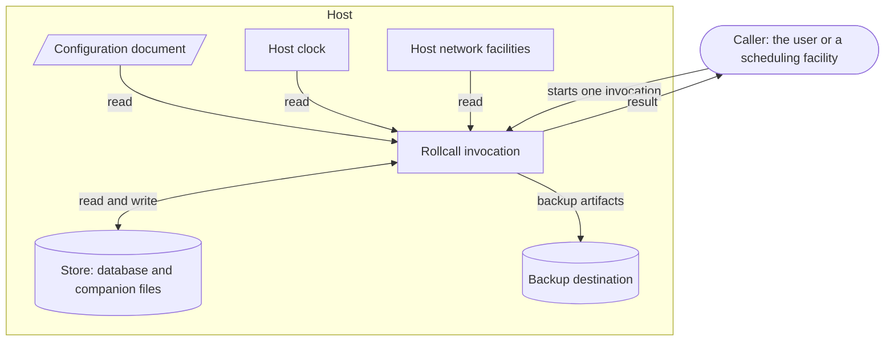
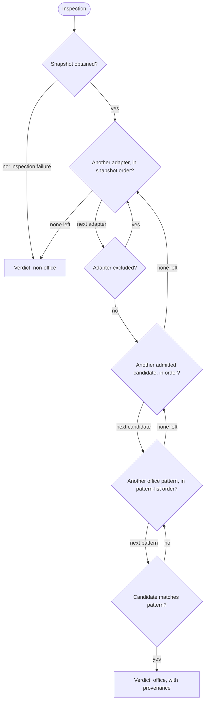
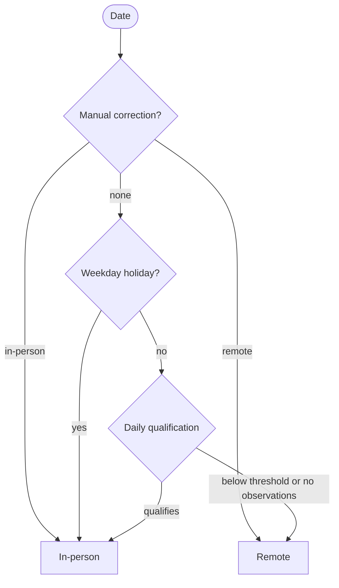
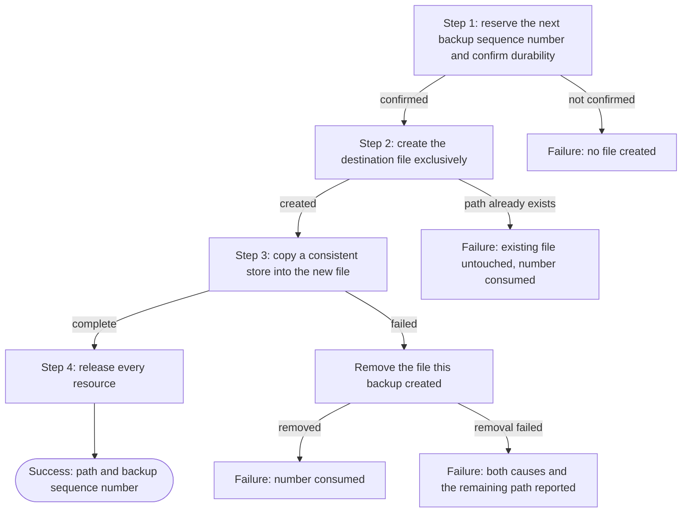
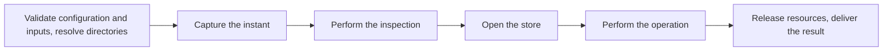
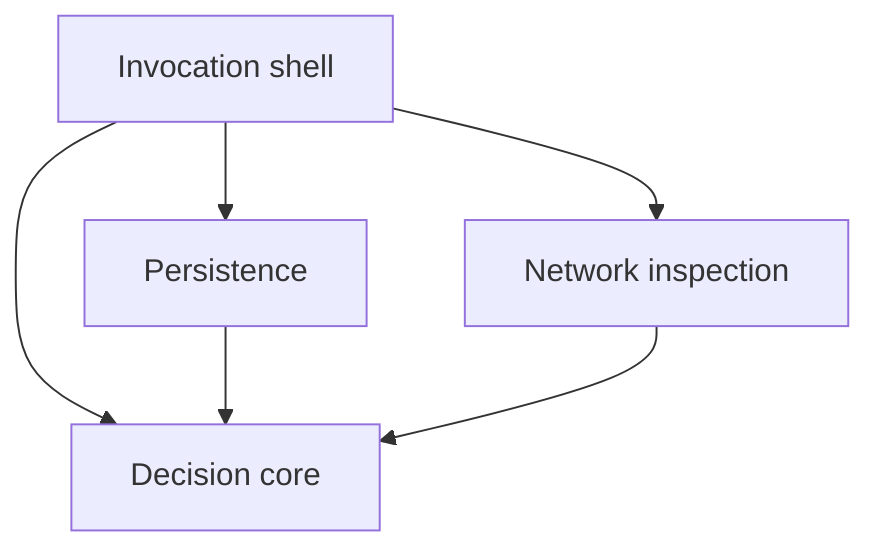

# Rollcall: Technical Proposal

|            |                                                                              |
|------------|------------------------------------------------------------------------------|
| **Status** | Draft for review                                                             |
| **Date**   | 2026-11-21                                                                   |
| **Scope**  | System definition at the level of behavior, guarantees, and responsibilities |

---

<!-- TOC -->

* [Rollcall: Technical Proposal](#rollcall-technical-proposal)
    * [Abstract](#abstract)
    * [1. Introduction](#1-introduction)
        * [1.1 Motivation](#11-motivation)
        * [1.2 Purpose of this document](#12-purpose-of-this-document)
        * [1.3 Document organization](#13-document-organization)
    * [2. Terminology](#2-terminology)
        * [2.1 Conventions](#21-conventions)
        * [2.2 Environment](#22-environment)
        * [2.3 Time](#23-time)
        * [2.4 Network evidence](#24-network-evidence)
        * [2.5 Attendance](#25-attendance)
        * [2.6 Records and backups](#26-records-and-backups)
        * [2.7 Components and settings](#27-components-and-settings)
    * [3. Goals, Non-goals, Design Principles, and Success Criteria](#3-goals-non-goals-design-principles-and-success-criteria)
        * [3.1 Goals](#31-goals)
        * [3.2 Non-goals](#32-non-goals)
        * [3.3 Design principles](#33-design-principles)
        * [3.4 Success criteria](#34-success-criteria)
    * [4. System Context](#4-system-context)
    * [5. Operations](#5-operations)
        * [5.1 Evidence](#51-evidence)
        * [5.2 Reports](#52-reports)
        * [5.3 Calendar management](#53-calendar-management)
        * [5.4 Protection](#54-protection)
        * [5.5 Resource access by operation](#55-resource-access-by-operation)
    * [6. Detection Model](#6-detection-model)
        * [6.1 From the host to suffix candidates](#61-from-the-host-to-suffix-candidates)
        * [6.2 Classification and admission](#62-classification-and-admission)
        * [6.3 Fixed verdicts](#63-fixed-verdicts)
        * [6.4 Evidence retained for audit](#64-evidence-retained-for-audit)
        * [6.5 Inspection failure](#65-inspection-failure)
        * [6.6 Detection without side effects](#66-detection-without-side-effects)
    * [7. Attendance Model](#7-attendance-model)
        * [7.1 Daily qualification](#71-daily-qualification)
        * [7.2 Holidays, manual corrections, and effective attendance](#72-holidays-manual-corrections-and-effective-attendance)
        * [7.3 Quarterly progress](#73-quarterly-progress)
        * [7.4 Timestamp regressions](#74-timestamp-regressions)
    * [8. Time Model](#8-time-model)
    * [9. Persistence and Backup](#9-persistence-and-backup)
        * [9.1 The store](#91-the-store)
        * [9.2 Record guarantees](#92-record-guarantees)
        * [9.3 Durability](#93-durability)
        * [9.4 Backup guarantees](#94-backup-guarantees)
        * [9.5 Restoring a backup](#95-restoring-a-backup)
        * [9.6 Concurrent invocations](#96-concurrent-invocations)
    * [10. Invocation Model](#10-invocation-model)
        * [10.1 Lifetime](#101-lifetime)
        * [10.2 Order of work](#102-order-of-work)
        * [10.3 Interruption](#103-interruption)
    * [11. Configuration](#11-configuration)
        * [11.1 Contents](#111-contents)
        * [11.2 Rules](#112-rules)
    * [12. Logical Architecture](#12-logical-architecture)
        * [12.1 Components](#121-components)
        * [12.2 Dependencies](#122-dependencies)
        * [12.3 Rationale](#123-rationale)
        * [12.4 Technology choices](#124-technology-choices)
    * [13. Platform Support](#13-platform-support)
        * [13.1 Network sources and their translation](#131-network-sources-and-their-translation)
        * [13.2 Assumptions](#132-assumptions)
        * [13.3 Storage facts](#133-storage-facts)
    * [14. Failure Handling Principles](#14-failure-handling-principles)
    * [15. Security and Privacy](#15-security-and-privacy)
        * [15.1 Access](#151-access)
        * [15.2 Retained data](#152-retained-data)
        * [15.3 Volume](#153-volume)
    * [16. Risks](#16-risks)
    * [17. Alternatives Considered](#17-alternatives-considered)
    * [18. Open Questions](#18-open-questions)
    * [19. Deferred to Detailed Design](#19-deferred-to-detailed-design)

<!-- TOC -->
---

## Abstract

Rollcall is a command-line program that keeps a personal, local record of the days on which its user worked in person at
an office, and reports progress toward a quarterly requirement for in-person days. It infers, from the network
configuration of the user's own computer, whether that computer was connected to an office network; it stores the
reading taken at each sample as append-only evidence; it lets the user correct the status of individual days and declare
holidays; and it produces consistent backups of its records. This proposal defines what the system is: its vocabulary,
its operations, the rules by which it reaches conclusions, the guarantees it offers about its records, and the division
of responsibilities among its parts. It deliberately stops short of low-level design.

---

## 1. Introduction

### 1.1 Motivation

An employer with a hybrid work arrangement may require a minimum number of in-person days per calendar quarter. Keeping
that tally by hand is error-prone: days are forgotten, holidays are miscounted, and the record cannot be checked after
the fact. A computer connected to an office network can carry evidence of that connection in its own network
configuration, in the form of the domain names that the office network assigns to it; Section 13 records, for each
platform, how this evidence is read and how far that reading has been verified. Rollcall reads that evidence at times
chosen by the user, records it, and turns the accumulated record into a daily and quarterly account of attendance.

### 1.2 Purpose of this document

This document fixes the definition of the system before detailed design begins. It is intended to be read from start to
finish. The Abstract and Section 1 use words in their ordinary sense. Section 2 defines every term that the rest of the
document uses in a technical sense, and each definition relies only on ordinary words and on terms defined before it.
Every section after Section 2 uses only terms defined there. Where the proposal depends on facts about operating systems
that have not yet been confirmed, it labels them as assumptions.

### 1.3 Document organization

Section 2 declares the terminology. Section 3 states the goals, non-goals, design principles, and success criteria.
Section 4 places the system in its environment. Sections 5 through 10 define the operations, the detection model, the
attendance model, the time model, persistence and backup, and the invocation model. Section 11 defines configuration.
Section 12 describes the logical architecture and the technology choices. Section 13 records platform support and its
assumptions. Section 14 states the principles of failure handling, and Section 15 addresses security and privacy.
Sections 16 through 19 record risks, alternatives considered, open questions, and the matters deferred to detailed
design.

---

## 2. Terminology

### 2.1 Conventions

The words **must** and **must not** state requirements of the proposed system. The word **may** states either a
permitted behavior or a possible outcome that the system does not prevent. Indicative statements in Sections 5 through
15 that describe Rollcall's behavior are also requirements.

Statements about operating-system and database-engine behavior on which the design depends are collected in Section 13,
where each carries one of three labels: **verified**, meaning observed directly during the preparation of this proposal,
by experiment or by reading the database engine's source; **measured**, meaning quantified by an experiment whose
conditions are stated; or **assumed**, meaning believed on the basis of documentation or prior work but not yet
observed.

### 2.2 Environment

**User.** The one person whose attendance Rollcall records.

**Host.** The computer on which Rollcall runs on the user's behalf, using the user's ordinary access rights.

**Caller.** Any agent outside Rollcall that starts it: the user at a terminal, or a scheduling facility that the user
has configured.

**Operation.** One unit of work that a caller may request. Section 5 defines the eleven operations.

**Invocation.** One run of Rollcall, started by a caller, that performs exactly one operation and then ends.

**Configuration.** The set of settings, supplied by the user in a document that the caller identifies, that govern an
invocation. Section 11 defines its contents.

**Interruption.** The end of an invocation without orderly completion, caused by external termination of its process, a
program defect, an operating-system crash, or loss of power to the host.

### 2.3 Time

**Captured instant.** The moment at which an invocation reads the host clock, at the full resolution that the clock
provides. An invocation captures at most one instant. Two captured instants are equal only if they are identical at that
resolution.

**Timezone rules.** The host's rules that assign to each instant the difference between local time and Coordinated
Universal Time (UTC).

**Offset.** The difference between local time and UTC that the timezone rules assign to the captured instant, to the
second.

**Timezone name.** The identifier of the timezone rules, when the host supplies one.

**Local date.** The calendar date of a captured instant, evaluated at its offset.

**Weekday** and **weekend date.** A date is a weekday if it falls on Monday through Friday, and a weekend date if it
falls on Saturday or Sunday. The classification belongs to the date itself, not to the date on which an operation runs.

### 2.4 Network evidence

**Network adapter.** A network interface reported by the host operating system. An adapter is **active** when the
operating system reports its operational status as up.

**Adapter name.** The operating system's name for an adapter. It may be empty, and it need not be unique among the
adapters of one host.

**Adapter kind.** The operating system's text describing an adapter's type. Its values differ between platforms, and it
may be empty.

**Domain name** and **label.** A domain name is a sequence of nonempty labels separated by single dots, such as
`corp.example`, whose labels are `corp` and `example`.

**DNS suffix.** A text that the operating system associates with an adapter for the purpose of name resolution. A DNS
suffix is compared after one trailing dot, if present, is removed. A DNS suffix is **malformed** if, after that removal,
it is not a domain name. An empty or malformed DNS suffix is retained as observed.

**Suffix source.** The role in which the operating system reports a DNS suffix. There are three sources:

- **primary**: the single connection-specific domain name of an adapter, on platforms that distinguish one;
- **search**: a domain that the operating system appends to unqualified names during resolution;
- **routing-only**: a domain that directs matching queries to an adapter's name servers without being used for search.

**Suffix candidate.** One DNS suffix reported for one adapter, together with its suffix source.

**Snapshot.** The complete list of active adapters produced by one successful reading of the host, in the order the
operating system reports them. For each adapter it contains the adapter name, the adapter kind, the adapter's suffix
candidates in the order the operating system reports them, and the adapter's IPv4 addresses. A snapshot may contain no
adapters.

**Inspection failure.** The outcome of a reading of the host that could not be completed. It identifies the step that
failed and, when the operating system supplies one, the operating system's error code. A partially completed reading is
an inspection failure, never a snapshot.

**Inspection.** One reading of the host's active adapters. An inspection produces either a snapshot or an inspection
failure.

**Office pattern.** A pattern, supplied by the user, that identifies the office network. A pattern takes one of two
forms:

- an **exact** pattern is a domain name containing no `*`, such as `corp.example`; it matches only a DNS suffix equal to
  that name;
- a **subdomain** pattern is `*.` followed by a domain name containing no `*`, called its **base name**, such as
  `*.corp.example`; it matches any DNS suffix formed by adding one or more labels in front of the base name, such as
  `host.corp.example` or `a.b.corp.example`, but not the base name itself and not a name that merely ends in the same
  characters, such as `evil-corp.example`.

Every other text is an invalid pattern: in particular, a text containing `*` anywhere other than as a whole leftmost
label, a text containing a whitespace character, a text ending in a dot, and a text with an empty label. Comparison
treats the ASCII letters A through Z as equal to a through z and treats every other character as equal only to itself.
An empty or malformed DNS suffix matches no office pattern.

**Pattern list.** The ordered list of office patterns in force for an invocation.

**Admission policy.** The rule that decides which suffix candidates may produce a match. It consists of:

- the set of **admitted suffix sources**; a candidate whose source is not admitted never matches;
- a list of **adapter exclusions**; each exclusion names either an adapter name or an adapter kind, and excludes every
  adapter whose name, or respectively kind, is exactly that text.

**Classification.** The application of a pattern list and an admission policy to a snapshot. Classification examines the
adapters in snapshot order and skips excluded adapters. Within each remaining adapter it examines the admitted suffix
candidates in order, and for each candidate it tries the office patterns in pattern-list order. The first adapter,
candidate, and pattern that match form the **match**.

**Matching rules.** The pattern forms, the comparison rule, the meaning of admission and exclusion, and the order of
classification, all as stated above. Each revision of the matching rules has a distinct **version**.

**Detection profile.** The pattern list, the admission policy, and the version of the matching rules, taken together. To
classify a snapshot with a detection profile is to apply its pattern list and admission policy under that version of the
matching rules.

**Verdict.** The outcome reached for one inspection: **office** when classification of its snapshot finds a match, and
**non-office** when classification finds no match or when the inspection failed.

**Provenance.** The identification of a match: the matched adapter, by its position in the snapshot; the matched suffix
candidate, by its position within that adapter, with its value and source; and the matched office pattern exactly as the
user supplied it.

**Observation.** The stored record of one inspection made in order to record attendance. It contains the captured
instant with its offset, either the snapshot or the inspection failure, the detection profile in force, the verdict,
and, for an office verdict, its provenance. The local date of an observation is the local date of its recorded instant
and offset.

**Sample.** The act of capturing an instant, performing one inspection, classifying the snapshot when there is one, and
storing the resulting observation. The operation that performs it is the **sample operation**.

**Ingestion order.** The order in which observations are stored. Each observation receives an **observation number**, a
positive integer that increases in ingestion order and is independent of the clock.

### 2.5 Attendance

**Office count** and **total count.** For one local date, the number of observations with an office verdict and the
number of all observations, respectively.

**Daily threshold.** A positive integer set in the configuration.

**Daily qualification.** The assessment of one date from its observations alone. A date is in exactly one of three
states: **no observations**; **below threshold**, when it has observations and its office count is less than the daily
threshold; and **qualifies**, when its office count is at least the daily threshold. Because the daily threshold is at
least 1, a date with no observations cannot qualify.

**Holiday.** A date that the user has declared a non-working day. A **weekday holiday** is a holiday that is a weekday;
a **weekend holiday** is a holiday that is a weekend date.

**Attendance status.** Either **in-person** or **remote**, as applied to a date. It is distinct from the verdict of an
observation, and a non-office verdict does not by itself make a date remote.

**Manual correction.** A user-recorded attendance status for one date, with an optional free-text reason. A date has at
most one manual correction.

**Effective attendance.** The attendance status of a date, determined in this order of precedence:

1. a manual correction, if one exists, decides;
2. otherwise, a weekday holiday is in-person;
3. otherwise, the date is in-person exactly when it qualifies.

A date with no observations, no holiday, and no manual correction is therefore remote.

**Quarter.** A calendar year together with one of its four quarters: January through March, April through June, July
through September, or October through December, each inclusive. The quarter **containing** a date is the quarter of that
date's year whose months include the date's month.

**Quarterly quota.** The number of in-person days, set in the configuration, required in every quarter.

**Timestamp regression.** An observation whose captured instant is strictly earlier than the latest captured instant
among the observations of the same local date that precede it in ingestion order. The first observation of a local date
is never a timestamp regression, and an observation whose instant equals that latest instant is not one.

### 2.6 Records and backups

**Store.** The single local database in which Rollcall keeps its records, together with the companion files that the
database engine manages beside it. Section 9.1 lists its contents.

**Live mode.** The mode in which the store operates during normal use, which allows readers to proceed while one
invocation writes. A file copied out of the store is produced in a different, standalone mode.

**Durable.** A change is durable when it is guaranteed to survive a subsequent loss of power to the host or crash of its
operating system, provided the storage device honors requests to flush data to it.

**Backup artifact.** A file that contains a complete, consistent copy of the store and opens without the store's
companion files.

**Backup sequence number.** A positive integer that Rollcall reserves durably before it creates each backup artifact.

**Backup.** The act of reserving a backup sequence number and copying the store into a backup artifact. The operation
that performs it is the **backup operation**.

**Restore.** The replacement of the store by a backup artifact, performed by the user outside Rollcall (Section 9.5).

**Flush.** A request that the operating system write a file's data to the storage device. An **ordinary flush** is the
platform's standard request; a **full flush** is a stronger request, offered by a platform whose standard request does
not guarantee that data reaches the device.

### 2.7 Components and settings

**Decision core.** The component that holds every rule by which Rollcall reaches a conclusion. It performs no input or
output.

**Persistence.** The component that owns the store and backups.

**Network inspection.** The component that performs inspections and translates each platform's report into suffix
candidates.

**Invocation shell.** The component that receives the caller's request, reads the configuration and the clock, and
orders the work of an invocation.

Section 12 states the responsibilities and dependencies of the four components in full.

**Reporting policy.** The quarterly quota and the daily threshold.

**Detection settings.** The pattern list and the admission policy.

**Location settings.** The directory that holds the store and the default directory for backup artifacts.

Section 11 states the constraints and defaults of every setting.

---

## 3. Goals, Non-goals, Design Principles, and Success Criteria

### 3.1 Goals

| ID  | Goal                                                                                                                                                                                  |
|-----|---------------------------------------------------------------------------------------------------------------------------------------------------------------------------------------|
| G-1 | Record, at each sample, what the host's network showed and the verdict reached from it, as append-only evidence with its provenance, subject to the durability limits of Section 9.3. |
| G-2 | Report effective attendance for any range of dates and progress toward the quarterly quota for any quarter.                                                                           |
| G-3 | Allow the user to record manual corrections and manage holidays without altering any observation.                                                                                     |
| G-4 | Retain with each observation enough evidence to explain its verdict and to identify the observations that a different detection profile would have classified differently.            |
| G-5 | Produce backup artifacts that are consistent, open independently, never overwrite an existing file, and are numbered by a sequence whose reservations survive power loss.             |
| G-6 | Run on Linux, macOS, and Windows hosts with the user's ordinary access rights and no supporting services beyond those of the operating system.                                        |

### 3.2 Non-goals

| ID  | Non-goal                                                                                | Reason                                                                                                                                      |
|-----|-----------------------------------------------------------------------------------------|---------------------------------------------------------------------------------------------------------------------------------------------|
| N-1 | Scheduling. Rollcall does not decide when to sample, and keeps no resident process.     | Each supported operating system provides a scheduling facility (assumption A-8); owning another would add a long-lived process for no gain. |
| N-2 | Proof of physical presence.                                                             | A matching DNS suffix shows a network connection, not the user's location.                                                                  |
| N-3 | Changing the host's network configuration, resolving names, or contacting another host. | Rollcall observes the host; it does not act on the network.                                                                                 |
| N-4 | Serving more than one user, or sharing a store across hosts.                            | The record is personal and local.                                                                                                           |
| N-5 | Detection by resolved host names or by address ranges.                                  | Reserved as possible future detection methods (Section 17).                                                                                 |
| N-6 | Repairing a damaged store, or migrating a store to a different structure.               | Silent repair or migration can destroy evidence; Rollcall reports such a store instead.                                                     |

### 3.3 Design principles

1. **Evidence before conclusions.** Each observation records what was observed and the detection profile applied to it.
2. **Fixed verdicts, derived assessments.** The verdict of an observation is fixed when the observation is stored. Every
   other conclusion, including daily qualification, effective attendance, and quarterly progress, is derived each time a
   result is produced and is never stored.
3. **One invocation, one operation.** Each invocation performs one operation and ends.
4. **Least access.** Each operation reads or writes only the resources it needs (Section 5.5).
5. **Refusal over guessing.** Rollcall never substitutes a default for something it cannot determine: unresolvable
   timezone rules, an inaccessible store, or an invalid stored value causes a reported failure, not a silent fallback.
6. **Contained variation.** Network-inspection behavior that differs between operating systems is confined to one
   component, and every other platform difference is confined to the component that owns the affected resource. The
   rules that reach conclusions are written once and are identical on every platform.

### 3.4 Success criteria

| ID   | Criterion                                                                                                                                                                                                                                                              |
|------|------------------------------------------------------------------------------------------------------------------------------------------------------------------------------------------------------------------------------------------------------------------------|
| SC-1 | For every observation with a snapshot, applying its recorded detection profile to its recorded snapshot reproduces its recorded verdict and provenance exactly.                                                                                                        |
| SC-2 | For the same snapshot and the same detection profile, the sample operation and the diagnose operation reach the same verdict and provenance.                                                                                                                           |
| SC-3 | Effective attendance agrees with the precedence of Section 2.5 for all 27 combinations of manual correction (none, in-person, remote), holiday status (none, weekday holiday, weekend holiday), and daily qualification (no observations, below threshold, qualifies). |
| SC-4 | Every backup artifact reported as complete opens on its own and passes the database engine's full integrity check, including when another invocation writes to the store during the copy.                                                                              |
| SC-5 | No two backup operations on one store receive the same backup sequence number, except across a restore (Section 9.5).                                                                                                                                                  |
| SC-6 | The rules of the decision core and the platform translations of Section 6.1 pass the same tests on Linux, macOS, and Windows development hosts.                                                                                                                        |

---

## 4. System Context

Rollcall runs entirely on the host. A caller starts an invocation; the invocation reads the configuration, reads the
host clock and network facilities as its operation requires, reads and writes the store as its operation requires,
returns its result to the caller, and ends.

No other application process participates. On Linux, inspection communicates with a local operating-system service
(assumption A-1); on every platform, Rollcall requires no database server, no background service of its own, and no
elevated privileges. More than one invocation may run at the same time against the same store, for example a scheduled
sample and a report requested by the user; Section 9.6 states how they coexist.

---

## 5. Operations

Rollcall offers eleven operations in four groups.

### 5.1 Evidence

| Operation    | Behavior                                                                                                                                                                                                                                                                               | Result                                                                                                                                                                                                                                       |
|--------------|----------------------------------------------------------------------------------------------------------------------------------------------------------------------------------------------------------------------------------------------------------------------------------------|----------------------------------------------------------------------------------------------------------------------------------------------------------------------------------------------------------------------------------------------|
| **Sample**   | Captures the instant, performs one inspection, classifies the snapshot with the current detection profile, and stores exactly one observation. When the inspection fails, it stores an observation with the inspection failure and a non-office verdict, and then reports the failure. | The verdict, the local date, that date's office and total counts including the new observation, and the date's daily qualification.                                                                                                          |
| **Diagnose** | Captures the instant, performs one inspection, and classifies the snapshot with the current detection profile. It never reads or writes the store.                                                                                                                                     | The timezone name and captured instant; every active adapter with its suffix candidates, IPv4 addresses, and whether it is excluded; for each candidate, whether it is admitted and whether it matches; and the verdict with its provenance. |

### 5.2 Reports

| Operation           | Behavior                                                                                                                                     | Result                                                                                                                                                                                            |
|---------------------|----------------------------------------------------------------------------------------------------------------------------------------------|---------------------------------------------------------------------------------------------------------------------------------------------------------------------------------------------------|
| **Quarter summary** | Selects the quarter containing a requested date and assesses every date in that quarter.                                                     | The quarter and its first and last dates; the number of in-person days; the quarterly quota; the number of days still required; the number of days left; and the weekday holidays in the quarter. |
| **Daily history**   | Assesses every date in a requested inclusive range, in ascending order, including dates with no observations. An inverted range is rejected. | For each date: its effective attendance, whether it is a holiday, whether it has a manual correction, and the observation numbers of its timestamp regressions.                                   |

The number of days still required is the quarterly quota minus the number of in-person days, or zero if that difference
is negative. The number of days left is the number of dates in the selected quarter that are on or after the
invocation's local date: the whole quarter when the quarter lies in the future, and zero when it lies in the past.

### 5.3 Calendar management

| Operation             | Behavior                                                                                                                                         | Result                                                         |
|-----------------------|--------------------------------------------------------------------------------------------------------------------------------------------------|----------------------------------------------------------------|
| **Set correction**    | Creates or replaces the manual correction for one date. Replacing a manual correction replaces its reason.                                       | Acknowledgment.                                                |
| **Remove correction** | Deletes the manual correction for one date.                                                                                                      | Acknowledgment, or a report that no manual correction existed. |
| **List corrections**  | Lists manual corrections in ascending date order, optionally bounded below, above, or both, inclusively. An inverted pair of bounds is rejected. | Each manual correction's date, attendance status, and reason.  |
| **Add holiday**       | Declares one date a holiday. Declaring an existing holiday succeeds and creates no duplicate.                                                    | Acknowledgment.                                                |
| **Remove holiday**    | Removes one holiday.                                                                                                                             | Acknowledgment, or a report that the date was not a holiday.   |
| **List holidays**     | Lists all holidays in ascending date order.                                                                                                      | The holiday dates, possibly none.                              |

Calendar management never alters an observation, and each of these operations changes only its own kind of record.

### 5.4 Protection

| Operation  | Behavior                                                                                                                                                   | Result                                                     |
|------------|------------------------------------------------------------------------------------------------------------------------------------------------------------|------------------------------------------------------------|
| **Backup** | Performs one backup into the configured backup directory, or into a destination directory supplied with the invocation. Section 9.4 states its guarantees. | The backup artifact's path and its backup sequence number. |

### 5.5 Resource access by operation

Each operation accesses only the resources marked in the following table.

| Operation                         | Configuration | Clock | Network | Store          | Backup destination |
|-----------------------------------|---------------|-------|---------|----------------|--------------------|
| Sample                            | read          | read  | read    | read and write | —                  |
| Diagnose                          | read          | read  | read    | —              | —                  |
| Quarter summary                   | read          | read  | —       | read           | —                  |
| Daily history                     | read          | —     | —       | read           | —                  |
| Set correction, Remove correction | read          | —     | —       | read and write | —                  |
| List corrections, List holidays   | read          | —     | —       | read           | —                  |
| Add holiday, Remove holiday       | read          | —     | —       | read and write | —                  |
| Backup                            | read          | read  | —       | read and write | write              |

An operation marked "read" for the store never changes its records. Any operation that uses the store creates it when it
does not exist and places it in live mode when it is not (Section 9.5); the database engine may also update its
companion files during a read.

---

## 6. Detection Model

### 6.1 From the host to suffix candidates

An inspection reads every active adapter and, for each, the DNS suffixes that the operating system associates with it.
Each operating system reports these in its own form; the network-inspection component (Section 12.1) translates each
platform's report into suffix candidates. The translation assigns each value its suffix source, preserves the order in
which the operating system reports adapters and values, and reports every value, including empty and repeated values. It
applies no judgment about which values matter: every rule that can affect a verdict belongs to classification. Section
13.1 records the translation for each platform.

### 6.2 Classification and admission

Classification follows the definition in Section 2.4. Its two policy inputs are the pattern list and the admission
policy:

- the **pattern list** states which domain names identify the office;
- the **admission policy** states which suffix sources may count as office evidence, and which adapters are never
  considered.

The following diagram traces one classification, from the outcome of an inspection to the verdict.

The admission policy exists because a domain name can appear on a host for reasons unrelated to location. Virtual
private network software can install the office domain on its tunnel adapter when the user connects from elsewhere
(assumption A-7). On Linux, such a domain can appear as a routing-only candidate, which an admission policy can decline
to admit. On macOS and Windows, routing-only candidates are not reported (Section 13.1), so such a domain appears as a
primary or search candidate; there, an adapter exclusion naming the tunnel adapter's name or kind is the means of
preventing an office verdict.

The proposed default admission policy admits the primary and search sources, does not admit the routing-only source, and
contains no adapter exclusions. Section 18 records this default as open for confirmation.

### 6.3 Fixed verdicts

The verdict of an observation is reached once, when the observation is stored, using the detection profile in force at
that moment, and it is never reached again. A later change to the pattern list, the admission policy, or the matching
rules affects only observations stored after the change. As a result, the verdicts of past observations do not depend on
the current configuration, and the office counts of past dates change only when observations are added to them or when
the store returns to an earlier committed state (Sections 9.3 and 9.5).

For every observation that contains a snapshot, applying its recorded detection profile to its recorded snapshot
reproduces its recorded verdict and provenance. An office verdict always has provenance, and a non-office verdict never
does.

### 6.4 Evidence retained for audit

Each observation retains its complete snapshot, including adapters that the admission policy excluded and candidates it
did not admit, together with the detection profile that produced its verdict. This retention serves two purposes:

1. it explains every verdict, because the evidence, the profile, and the provenance are all on record;
2. it makes it possible to determine, for any alternative detection profile whose matching rules Rollcall implements,
   which past observations would have received a different verdict.

Rollcall retains the ability to apply every version of the matching rules that appears in its record. Retained evidence
never changes a stored verdict; the user changes the effective attendance of a past date by recording a manual
correction for it.

### 6.5 Inspection failure

When an inspection fails, the sample operation stores an observation that contains the inspection failure and a
non-office verdict, and only then reports the failure to the caller. An inspection failure is therefore distinguishable
in the record from a completed inspection that found no match. If the observation cannot be stored, the storage failure
is reported instead, and no observation exists. The diagnose operation reports an inspection failure without storing
anything.

### 6.6 Detection without side effects

Inspection only reads. Rollcall never changes adapter settings, never resolves names, never contacts another host, and
never combines readings from more than one inspection into one snapshot.

---

## 7. Attendance Model

### 7.1 Daily qualification

Daily qualification is derived from the office count of a date and the daily threshold in the current configuration.
Because verdicts are fixed (Section 6.3), adding observations to a date can raise its office count but never lower it;
under an unchanged daily threshold, a date that qualifies continues to qualify unless the store returns to an earlier
committed state. A change to the daily threshold may change the daily qualification of any date, past or future, without
any change to the record.

### 7.2 Holidays, manual corrections, and effective attendance

Effective attendance is derived for every date from its manual correction, its holiday status, and its daily
qualification, by the precedence stated in Section 2.5:

Its consequences are as follows:

- a manual correction applies to a date with no observations and to a holiday;
- a weekday holiday is in-person without any observations;
- a weekend holiday is reported as a holiday but receives no automatic credit; it is in-person only by daily
  qualification or by manual correction.

### 7.3 Quarterly progress

The quarter summary counts each date of the selected quarter at most once, according to its effective attendance. It
includes dates later than the invocation's local date: a future weekday holiday or a future in-person manual correction
already counts toward the quarter. The quarterly quota is the same for every quarter.

### 7.4 Timestamp regressions

The captured instants of observations need not increase in ingestion order: a time correction can set the host clock
back, and concurrent samples can be stored in an order different from the order of their captured instants, because each
sample captures its instant before it opens the store (Section 10.2). Rollcall never alters or discards an observation
for this reason. Daily history instead reports, for each date, the observation numbers of its timestamp regressions.
Comparison uses captured instants, never local clock readings, so a change of offset, such as the repeated local hour at
the end of daylight-saving time, does not by itself produce a timestamp regression. Because timestamp regressions are
defined within one local date, a backward clock movement across midnight that places an observation on an earlier local
date is reported only when that earlier date already holds an observation with a later captured instant; its position
relative to the observations of the later date is not reported.

---

## 8. Time Model

An invocation that needs the clock captures one instant and uses it throughout. The host's timezone rules determine the
offset of that instant. An observation records the captured instant and its offset, and its local date is determined by
them; one rule in the decision core defines that determination.

If the host's timezone setting names rules that cannot be resolved, no reliable offset exists, and the invocation fails
before it reads the network or the store; Rollcall never assumes UTC in their place. A host that supplies no timezone
name is not a failure, provided its timezone rules yield an offset.

Results that depend on the current date, such as the number of days left in a quarter, use the invocation's local date.
Each backup artifact is named with its backup sequence number and the captured instant expressed in UTC, so that its
name is unique and does not depend on the host's timezone.

---

## 9. Persistence and Backup

### 9.1 The store

The store is a single local database file, managed by an embedded database engine (Section 12.4), together with the
companion files that the engine maintains beside it. It holds observations, including their snapshots or inspection
failures and their detection profiles; manual corrections; holidays; and the most recently reserved backup sequence
number. The store must reside on a file system local to the host. Any operation that uses the store creates it, and the
directory that contains it, when they do not exist.

### 9.2 Record guarantees

1. **Append-only evidence.** No operation modifies or deletes an observation. Each sample adds exactly one observation;
   repeated samples are never merged.
2. **Atomic changes.** Each sample, each change to a manual correction, and each change to holidays is applied
   completely or not at all. Everything that an observation contains is committed together.
3. **Consistent reports.** Each report reads observations, manual corrections, and holidays from one consistent view of
   the store, so that a change committed by a concurrent invocation is either wholly included or wholly excluded.
4. **Validation on read.** A stored value that violates its rules causes a reported failure; Rollcall never substitutes
   a default for an invalid stored value.
5. **No repair or migration.** A store that fails identity or structure validation is reported and left unmodified.
   Damage is reported when the database engine encounters it. Apart from the engine's own recovery of incomplete changes
   and the switch into live mode (Section 9.5), Rollcall never repairs, migrates, or otherwise rewrites a store.

### 9.3 Durability

All guarantees in this section assume a storage device that honors requests to flush data to it.

Ordinary changes, which are observations, manual corrections, and holidays, are committed without forcing them to the
storage device at each commit. A loss of power or a crash of the operating system can therefore discard ordinary changes
committed since the database engine last forced its files to the device; the store then returns to one earlier committed
state, in which recently added records may be absent and recently removed manual corrections or holidays may be present
again. This proposal does not bound the size of that window; it depends on the engine's schedule for forcing its files
to the device. On macOS, an ordinary flush does not reach the storage device (Section 13.3), so Rollcall requests a full
flush wherever the consistency of the store depends on one.

The reservation of a backup sequence number is the one change that receives the strongest durability the host provides:
once Rollcall confirms a reservation, the number remains consumed even if power is lost immediately afterward.

### 9.4 Backup guarantees

A backup proceeds in a fixed order, and each step depends on the success of the one before it:

1. **Reserve.** Rollcall reserves the next backup sequence number and confirms that the reservation is durable.
2. **Create.** Rollcall creates the destination file exclusively. If a file already exists at that path, the backup
   fails and the existing file is left untouched. Where the platform allows, Rollcall confirms that the file into which
   it copies is the file it created.
3. **Copy.** Rollcall writes into the new file a consistent copy of the store that includes every change committed
   before the copy began. The copy must open on its own, without the store's companion files. During the copy, the
   database engine writes a temporary file beside the destination.
4. **Release and report.** Rollcall closes every resource it holds and only then reports success with the backup
   artifact's path and backup sequence number.

A reserved backup sequence number is never issued again by the same store, whether the backup succeeds, fails, or is
interrupted; Section 9.5 states the one exception. If a backup fails after creating its file, Rollcall attempts to
remove that file and no other; if removal also fails, Rollcall reports both failures and the path of the remaining file.
Rollcall does not remove the temporary file that the database engine writes beside the destination. A reported success
does not guarantee that the backup artifact itself survives a loss of power that follows immediately. Backup sequence
numbers order reservations; when backups overlap, they do not order backup artifacts by the freshness of their contents.

### 9.5 Restoring a backup

None of the eleven operations performs a restore; the user restores a backup artifact by copying it into the place of
the store. A restore must be performed while no invocation is running, and the replaced store's companion files must be
removed before the backup artifact is copied into place, because a companion file left from the replaced store can
corrupt the restored store. A restore discards every record made after the backup artifact was taken, and it returns the
backup sequence to the number recorded in the artifact, so numbers issued after that point can be issued again.

A backup artifact is in standalone mode. When Rollcall opens a store, it first confirms that the file is a Rollcall
store with a compatible structure; only then, and only if necessary, does it switch the store into live mode. A file
that fails this identity check is reported and left unmodified.

### 9.6 Concurrent invocations

Any number of invocations may use one store at the same time. The database engine's locking serializes their changes.
Every change requests write access at its start, so that contention is resolved by waiting rather than by failure
partway through. When an invocation cannot obtain access within a bounded waiting time, it fails and reports contention
rather than proceeding. The switch into live mode (Section 9.5) is the one exception: it fails at once, without waiting,
if another invocation has the store open (Section 13.3). Two concurrent backups never receive the same backup sequence
number and never lose a reservation.

---

## 10. Invocation Model

### 10.1 Lifetime

Each invocation performs one operation and ends. Rollcall keeps no process running between invocations and owns no
schedule; the user's scheduling facility starts the sample operation at whatever cadence the user chooses.

### 10.2 Order of work

Every invocation proceeds through the following stages, omitting those its operation does not need:

1. read and validate the entire configuration and the operation's inputs, and resolve every directory once;
2. capture the instant;
3. perform the inspection;
4. open the store;
5. perform the operation;
6. release every resource and deliver the result.

The order has two consequences. An invalid configuration, an invalid input, or unresolvable timezone rules end the
invocation before the network or the store is touched. The inspection completes before the store is opened, so a sample
never holds the store open while it waits on the operating system.

### 10.3 Interruption

Rollcall installs no handler for termination requests; external termination therefore causes an interruption. After an
interruption, the store remains consistent, because the database engine recovers any incomplete change on its next use.
An interrupted sample has stored either its whole observation or none of it. An interrupted backup may leave an empty,
partial, or complete file at its destination, possibly with the temporary file named after it; none of these is
confirmed as a backup artifact, Rollcall does not remove them later, and only a reported success confirms a backup
artifact. The backup sequence number of an interrupted backup is consumed if its reservation was confirmed, and may be
consumed even if confirmation was never received.

---

## 11. Configuration

### 11.1 Contents

The caller identifies the configuration document when it starts an invocation. The configuration has three parts.

| Part                   | Setting                 | Constraint                        | Default                               |
|------------------------|-------------------------|-----------------------------------|---------------------------------------|
| **Reporting policy**   | Quarterly quota         | An integer from 0 through 92      | None; required                        |
|                        | Daily threshold         | An integer of at least 1          | None; required                        |
| **Detection settings** | Pattern list            | At least one valid office pattern | None; required                        |
|                        | Admitted suffix sources | At least one suffix source        | Primary and search (provisional, Q-1) |
|                        | Adapter exclusions      | Any number, including none        | None                                  |
| **Location settings**  | Store directory         | A directory                       | None; required                        |
|                        | Backup directory        | A directory                       | None; required                        |

A backup invocation may supply its own destination directory, which applies to that invocation only.

### 11.2 Rules

1. **Validated before use.** Every setting is validated before the invocation touches the clock, the network, or the
   store, including settings that the requested operation does not use.
2. **Fixed per invocation.** The configuration is read once per invocation and does not change during it.
3. **Unrecognized settings are rejected** (provisional, Q-4). A setting that Rollcall does not define causes a
   validation failure, so that a misspelled setting cannot silently leave its intended value at a default.
4. **Directories resolve once.** A directory setting may begin with a reference to the user's profile directory. A
   relative directory resolves against the working directory in which the invocation started. Each invocation resolves
   its directories once and never falls back to a different location if access fails.
5. **Effect of change.** A change to the reporting policy applies to every result produced afterward, including results
   for past dates. A change to the detection settings applies only to samples taken afterward (Section 6.3).

---

## 12. Logical Architecture

### 12.1 Components

Rollcall consists of four components.

| Component              | Responsibility                                                                                                                                                                                                                                                                    | Restriction                                                                                                                                                                                                                                      |
|------------------------|-----------------------------------------------------------------------------------------------------------------------------------------------------------------------------------------------------------------------------------------------------------------------------------|--------------------------------------------------------------------------------------------------------------------------------------------------------------------------------------------------------------------------------------------------|
| **Decision core**      | Classification and the matching rules, validation of the configuration and of individual values, daily qualification, effective attendance, quarterly arithmetic, timestamp regressions, determination of the local date, resolution of directories, and the assembly of results. | Performs no input or output and never reads the clock; every input arrives as a value.                                                                                                                                                           |
| **Persistence**        | The store and backups: creation, identity and structure validation, the switch into live mode, atomic changes, consistent reads, durable reservation, exclusive creation, and copying.                                                                                            | The only component that uses the database engine.                                                                                                                                                                                                |
| **Network inspection** | One or more readers per operating system, and the translation from each platform's report to suffix candidates.                                                                                                                                                                   | The only component that contains operating-system-specific network code, and the only component whose own code may use low-level operating-system interfaces that bypass the memory-safety checks of the implementation language (Section 12.4). |
| **Invocation shell**   | The command-line interface; reading the configuration document and supplying it to the decision core for validation; reading the clock and the user's working and profile directories; ordering the stages of Section 10.2; and presenting results and failures.                  | Contains no attendance or detection rule.                                                                                                                                                                                                        |

### 12.2 Dependencies

Each arrow points from a component to a component it depends on.

The decision core depends on no other component. Persistence and network inspection depend only on the decision core.
The invocation shell depends on all three. Neither persistence nor network inspection depends on the other. Each
component is built as a separate unit, so every dependency between components must be declared, an undeclared dependency
fails the build, and a declared dependency that violates these rules is visible in review.

### 12.3 Rationale

1. Every rule that produces a conclusion lives in the decision core, so it is written once, behaves identically on every
   platform, and can be tested on any development computer without a network or a database.
2. The translation from a platform's report to suffix candidates does not need to run on the platform whose report it
   translates, so the translation for every platform is tested on every development computer; only the readers that call
   the operating system are specific to a platform.
3. Confining the database engine to the persistence component keeps its internal mechanisms, including any concurrent
   work within the database library, invisible to the rest of the system.
4. Confining low-level operating-system interfaces to the network-inspection component keeps the code written for the
   other three components free of operations that bypass memory-safety checks.
5. Within an invocation, work is sequential. Persistence completes each request before returning, so no other component
   runs or waits on concurrent work. The invocation shell obtains the clock reading and the snapshot through replaceable
   sources, so every operation can be exercised with controlled time and controlled network readings.

### 12.4 Technology choices

Rollcall is implemented in Rust and keeps its records with the embedded SQLite database engine. Rust provides memory
safety by default and produces a single executable that requires no runtime installation. SQLite provides atomic
transactions, consistent reads alongside a concurrent writer, and the ability to write a consistent copy of a live store
into a new file while other invocations continue to use it. It requires no server and keeps one database file and the
companion files it manages. Rollcall carries its own copy of the engine rather than using the one supplied by the host,
because the copy supplied by macOS was observed to refuse the copy procedure of Section 9.4 (Section 13.3). The
selection of libraries is deferred to detailed design.

---

## 13. Platform Support

### 13.1 Network sources and their translation

| Platform | Source of DNS suffixes                                                                                                                                           | Primary                        | Search                          | Routing-only                | Evidence                                                                                                      |
|----------|------------------------------------------------------------------------------------------------------------------------------------------------------------------|--------------------------------|---------------------------------|-----------------------------|---------------------------------------------------------------------------------------------------------------|
| Linux    | The operating system's resolver service, read over the local system message bus; each active link reports a list of domains, each marked as routing-only or not. | Not distinguished              | Domains not marked routing-only | Domains marked routing-only | Verified in a container on 64-bit ARM; assumed on 64-bit x86.                                                 |
| macOS    | The system configuration store; each network service reports one domain name and a list of search domains, and names the interface it uses.                      | The service's domain name      | The service's search domains    | Not reported                | The read path is verified on one host that had no domains configured; reading a configured domain is assumed. |
| Windows  | The operating system's adapter enumeration; each adapter reports one connection-specific suffix and a list of suffixes.                                          | The connection-specific suffix | The suffix list                 | Not reported                | Assumed, on the basis of prior work that confirmed the facility exists.                                       |

On every platform the result has the same form: an ordered list of active adapters, each with an ordered list of suffix
candidates. All classification takes place in the decision core.

### 13.2 Assumptions

| ID  | Assumption                                                                                                                                                                      | Consequence if false                                                                                         |
|-----|---------------------------------------------------------------------------------------------------------------------------------------------------------------------------------|--------------------------------------------------------------------------------------------------------------|
| A-1 | Linux hosts run the resolver service described in Section 13.1.                                                                                                                 | Hosts without it require a second Linux reader; until one exists, they cannot be inspected.                  |
| A-2 | The Windows suffix fields carry the values described in Section 13.1.                                                                                                           | The Windows translation changes; no other component changes.                                                 |
| A-3 | The user's profile directory is given by the conventional home-directory setting on Linux and macOS, and by the user-profile setting on Windows.                                | Only the source of the profile directory changes, in the invocation shell; the resolution rule is unchanged. |
| A-4 | On Linux, routing-only domains are those installed to direct queries, such as by virtual private network software, rather than to identify the local network.                   | The proposed default admission policy may need revision.                                                     |
| A-5 | On Linux and Windows, an ordinary flush reaches the storage device.                                                                                                             | Durability on those platforms requires the full-flush treatment that Section 9.3 applies to macOS.           |
| A-6 | Linux, macOS, and Windows hosts honor the exclusive creation of a file at a path that does not exist.                                                                           | Backup step 2 cannot guarantee that an existing file is never overwritten.                                   |
| A-7 | Virtual private network software can install the office domain on its tunnel adapter, as a routing-only domain on Linux and as a primary or search domain on macOS and Windows. | The admission-policy discussion of Section 6.2 overstates the risk it addresses.                             |
| A-8 | Each supported operating system provides a facility that can start a program at intervals chosen by the user.                                                                   | The user needs a separately installed scheduler.                                                             |

### 13.3 Storage facts

| Fact                                                                                                                                                                                                                      | Label                                    |
|---------------------------------------------------------------------------------------------------------------------------------------------------------------------------------------------------------------------------|------------------------------------------|
| On macOS, an ordinary flush is documented by the operating system as not reaching the storage device, and a full flush as reaching it.                                                                                    | Assumed (operating-system documentation) |
| On macOS, a reservation committed with a full flush took a median of 4.0 ms (range 3.0 to 5.1 ms), against a median of 0.149 ms with an ordinary flush (30 single-reservation commits each, one host, unoptimized build). | Measured                                 |
| When the database engine opens a database file beside which it finds a leftover companion file, it applies that companion file before any check that Rollcall performs.                                                   | Verified (engine source)                 |
| The switch into live mode requires exclusive access and fails at once, without waiting, when another connection has the store open.                                                                                       | Verified (engine source)                 |
| The copy of SQLite supplied with macOS refused to write a consistent copy into an empty, pre-created file; the copy distributed with the engine's source accepted it.                                                     | Verified                                 |
| A backup artifact produced by the copy procedure of Section 9.4 opened on its own, in standalone mode, and included changes still held in the live store's companion files.                                               | Verified                                 |

---

## 14. Failure Handling Principles

1. **No effect before validation.** An invalid configuration, invalid operation input, or unresolvable timezone rules
   end the invocation before any record is written.
2. **No partial results.** A failed operation returns a failure, never a partial result presented as success.
3. **Inspection failure is evidence.** In the sample operation, an inspection failure becomes a stored observation
   before it is reported (Section 6.5).
4. **Refusal over repair.** An invalid stored value, an incompatible store, or an unusable location is reported, never
   repaired, replaced, or bypassed.
5. **Defects interrupt.** A program defect ends the invocation as an interruption; it is never reported as an ordinary
   failure of the requested operation.
6. **Failures are specific.** A reported failure identifies what failed and the resource involved.

The classification of failures into categories, and their presentation to callers, is deferred to detailed design.

---

## 15. Security and Privacy

### 15.1 Access

Rollcall runs with the user's ordinary access rights and requires no elevated privileges. It opens no connection to
another host; on Linux it communicates with a local operating-system service (assumption A-1). Its records reside only
in the store and in the backup destinations that the user selects.

### 15.2 Retained data

Each observation that contains a snapshot retains the adapter name, adapter kind, suffix candidates, and IPv4 addresses
of every active adapter at the moment of the sample, whether or not the adapter was relevant to the verdict. Over time
this record forms a detailed history of the networks to which the host was connected, including home, travel, and public
networks, from which the user's locations can be inferred. Because observations are append-only, no operation removes
this history, and every backup artifact contains it in full.

### 15.3 Volume

At an assumed cadence of one sample every 5 minutes on a host that runs continuously, a store receives 105,120
observations in a 365-day year. The size of one observation's content is estimated at 74 to 4,666 bytes, on the
following basis:

- per adapter, an adapter name and an adapter kind of 8 to 64 bytes each, 1 to 5 suffix candidates of 8 to 64 bytes plus
  1 byte for the source, and 1 to 3 IPv4 addresses of 4 bytes each, giving 29 to 465 bytes;
- 2 to 10 active adapters, giving 58 to 4,650 bytes;
- 16 bytes for the captured instant and offset.

The estimate excludes the database engine's per-record overhead and the space taken by detection profiles, whose storage
is deferred to detailed design. On that basis the content of the store grows by 7.8 to 490.5 MB (decimal) per year. Both
figures are estimates; neither has been measured.

---

## 16. Risks

| ID   | Risk                                                                                                                                                                                                                                      | Basis                                                                                                                                      | Consequence                                                                                                                                                         | Mitigation                                                                                                                                      |
|------|-------------------------------------------------------------------------------------------------------------------------------------------------------------------------------------------------------------------------------------------|--------------------------------------------------------------------------------------------------------------------------------------------|---------------------------------------------------------------------------------------------------------------------------------------------------------------------|-------------------------------------------------------------------------------------------------------------------------------------------------|
| R-1  | An admission policy that is too broad produces office verdicts for connections made from elsewhere, such as through a virtual private network. On macOS and Windows the proposed default admits such a connection's domain (Section 6.2). | Assumption A-7.                                                                                                                            | Because verdicts are fixed, the affected observations keep an office verdict permanently.                                                                           | Adapter exclusions; on Linux, not admitting routing-only candidates; manual corrections for affected dates; retained evidence to identify them. |
| R-2  | An admission policy that is too narrow produces non-office verdicts for office connections.                                                                                                                                               | On Linux no candidate has the primary source (Section 13.1), so a policy admitting only the primary source finds no office evidence there. | Office verdicts are under-counted permanently, so affected dates may fail to qualify.                                                                               | The proposed default admits the search source; manual corrections.                                                                              |
| R-3  | Retained evidence forms a location history that no operation removes.                                                                                                                                                                     | Section 15.2.                                                                                                                              | Disclosure of the store or of a backup artifact exposes the user's movements.                                                                                       | Local storage only; the user chooses backup destinations; retention controls are open (Q-3).                                                    |
| R-4  | A change to the matching rules made without a new version makes the audit record misleading.                                                                                                                                              | Section 6.4 relies on the recorded version identifying the rules that produced each verdict.                                               | An audit attributes a verdict to the wrong rules.                                                                                                                   | Every revision of the matching rules receives a distinct version, and every version in the record remains implemented.                          |
| R-5  | The first invocation to open a restored store fails at once, without waiting, if another invocation has the store open, because the switch into live mode requires exclusive access. This applies to reports as well.                     | Database engine source.                                                                                                                    | A report or sample fails after a restore.                                                                                                                           | Section 9.5 requires that restores take place while no invocation runs; a later invocation succeeds.                                            |
| R-6  | Ordinary changes can be lost on power loss or operating-system crash.                                                                                                                                                                     | Section 9.3.                                                                                                                               | Recent observations, manual corrections, or holidays may be absent, and recently removed ones may reappear.                                                         | Accepted: the strongest durability is reserved for backup sequence numbers, where reuse would be harmful.                                       |
| R-7  | Restoring a backup returns the backup sequence to an earlier number.                                                                                                                                                                      | Section 9.5.                                                                                                                               | Backup sequence numbers issued after the restored artifact was taken can be issued again; artifact names remain distinct because they include the captured instant. | Documented restore procedure; a restore operation is open (Q-5).                                                                                |
| R-8  | A later release that changes the structure of the store cannot open stores created by earlier releases, because Rollcall does not migrate stores (N-6).                                                                                   | Section 9.2 item 5.                                                                                                                        | Upgrading Rollcall can make an existing store unusable.                                                                                                             | The identity check reports the incompatibility without modifying the store; an explicit, user-invoked migration is open (Q-6).                  |
| R-9  | A scheduling facility that stops starting the sample operation produces no observations and no warning.                                                                                                                                   | Rollcall owns no schedule (N-1).                                                                                                           | Affected dates other than weekday holidays are remote unless corrected.                                                                                             | Daily history shows dates with no observations; the user verifies the schedule.                                                                 |
| R-10 | A relative directory setting resolves against the working directory of the invocation, which a scheduling facility may set differently from a terminal.                                                                                   | Section 11.2 rule 4.                                                                                                                       | Scheduled and interactive invocations use different stores.                                                                                                         | Recommend absolute directory settings or the profile-directory reference.                                                                       |

---

## 17. Alternatives Considered

| Alternative                                                                                                                               | Reason not chosen                                                                                                                                                                                                                                                                                                                                                                 |
|-------------------------------------------------------------------------------------------------------------------------------------------|-----------------------------------------------------------------------------------------------------------------------------------------------------------------------------------------------------------------------------------------------------------------------------------------------------------------------------------------------------------------------------------|
| **Derive verdicts when results are produced**, from the retained evidence and the current detection profile.                              | This would let a policy correction reclassify history, but results for past periods would change whenever the detection settings change, and every report would repeat the classification of every observation in its range. Fixed verdicts make past results stable, and the retained evidence still identifies affected observations for correction.                            |
| **Reduce each adapter to one DNS suffix** inside each platform reader.                                                                    | The selection rule would be written once per platform, and the values not selected would be lost before they could be recorded.                                                                                                                                                                                                                                                   |
| **Other detection signals**: the name of the wireless network, the identity of the network gateway, or the range of the host's addresses. | A DNS suffix is present on both wired and wireless connections and is assigned by the office network's administrators. A wireless network name is absent on wired connections; a gateway identity requires reading address-resolution data; private address ranges are reused by home networks. Resolved names and address ranges remain reserved for future consideration (N-5). |
| **A resident background service** that samples on a timer.                                                                                | It duplicates the host's scheduling facility and adds a long-running process with its own lifecycle and failure modes.                                                                                                                                                                                                                                                            |
| **A separate database server.**                                                                                                           | One user on one host needs no server; an embedded engine provides the required transactions and consistency.                                                                                                                                                                                                                                                                      |
| **Store daily assessments** alongside the evidence.                                                                                       | A change to the daily threshold, a manual correction, or a holiday would require recomputing stored assessments, which could then disagree with their inputs.                                                                                                                                                                                                                     |
| **Back up by copying the database file directly.**                                                                                        | A direct copy can miss committed changes held in the companion files and can capture an inconsistent state.                                                                                                                                                                                                                                                                       |

---

## 18. Open Questions

| ID  | Question                                                                                                                                                                                                            | Proposed answer                                                                                    |
|-----|---------------------------------------------------------------------------------------------------------------------------------------------------------------------------------------------------------------------|----------------------------------------------------------------------------------------------------|
| Q-1 | Which suffix sources should the default admission policy admit?                                                                                                                                                     | The primary and search sources (Section 6.2), with the limitation recorded in R-1.                 |
| Q-2 | Should Rollcall provide an operation that reports which past observations an alternative detection profile would classify differently?                                                                              | Not in the first release; the retained evidence makes it possible later.                           |
| Q-3 | Should the user be able to limit or purge retained network evidence?                                                                                                                                                | Unresolved. Any such control conflicts with the append-only guarantee and requires its own design. |
| Q-4 | Should unrecognized configuration settings be rejected?                                                                                                                                                             | Yes (Section 11.2 rule 3), pending confirmation.                                                   |
| Q-5 | Should Rollcall provide a restore operation that refuses to run while the store is in use, removes the replaced store's companion files, and carries the backup sequence forward so that no number is issued twice? | Yes, in a later release.                                                                           |
| Q-6 | Should a later release offer an explicit, user-invoked migration of a store to a new structure?                                                                                                                     | Unresolved; N-6 excludes only silent migration.                                                    |

---

## 19. Deferred to Detailed Design

The following matters are outside the scope of this proposal and will be settled in detailed design:

- the representation of records in the store, and the store's structure;
- the internal structure of each component and the interfaces between components;
- the classification of failures, their presentation, and the program's exit statuses;
- the command-line syntax, the format of results, and the defaults of operation inputs;
- the format and default location of the configuration document;
- the bounded waiting time for store access;
- the selection of libraries;
- the testing strategy;
- the delivery plan and its milestones.
